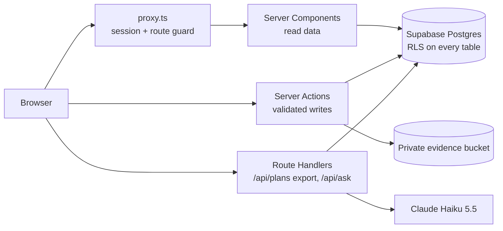

# Beyond the Rumour Mill

**Placement prep from evidence, not hostel rumours.**

LPU CA2 project **P08**, built for **INT252** (React) and **INT257** (Next.js).
Live: **https://clg.143.lat**

Students without senior contacts prepare blind, from WhatsApp forwards and hostel gossip ("Amazon only asks DP", "one backlog and you're out"). This app puts three things in one place, for everyone:

1. **The official rules** of each campus drive, and whether *you* qualify.
2. **Interview experiences from placed seniors**, counted only after the placement cell verifies them.
3. **A week-by-week prep plan** built from what verified seniors were actually asked.

A rumour only becomes advice when verified experiences back it.

| Doc | What's in it |
|---|---|
| [`docs/ARCHITECTURE.md`](docs/ARCHITECTURE.md) | System diagram, **database architecture** (ER diagram, security layers), data flow, **UI architecture** (every page and component), what we used and why |
| [`SYLLABUS.md`](SYLLABUS.md) | Every INT252 / INT257 topic → the exact file that uses it, and what we deliberately left out |
| [`docs/demo-script.md`](docs/demo-script.md) | Step-by-step demo for the viva |
| [`docs/design/design-system.md`](docs/design/design-system.md) | Colours, type, themes, motion |

---

## Contents

- [The three modules](#the-three-modules)
- [Features](#features)
- [Tech stack](#tech-stack)
- [Architecture at a glance](#architecture-at-a-glance)
- [Folder structure](#folder-structure)
- [Run it locally](#run-it-locally)
- [Environment variables](#environment-variables)
- [Scripts and tests](#scripts-and-tests)
- [Deployment](#deployment)
- [Ask: the AI project guide](#ask-the-ai-project-guide)
- [Security and privacy](#security-and-privacy)
- [Data and trust rules](#data-and-trust-rules)
- [Limits](#limits)

---

## The three modules

| P08 module | What a student can do | Pages | Logic |
|---|---|---|---|
| **1. Placement information** | Browse campus drives; see eligibility rules (CGPA, backlogs, 10th/12th %, branch, grad year), date and rounds; filter to "drives I'm eligible for"; see exactly which rule fails | `/drives`, `/drives/[id]`, `/companies` | `lib/placement/` |
| **2. Experience repository** | Read verified senior experiences and how often each topic was asked; share your own (with optional evidence file); check a rumour against the data | `/experiences`, `/experiences/new`, `/rumour-check`, `/admin` | `lib/experiences/` |
| **3. Student preparation** | Generate a dated, week-by-week checklist for a drive; tick items off; track progress; export it as Markdown | `/dashboard`, `/dashboard/plans/[id]` | `lib/preparation/` |

**Integration:** company requirement → relevant verified experiences → your prep plan. On any drive page, *Generate my prep plan* reads the drive's rounds (module 1) and the verified experiences for that company and role (module 2), then builds the plan (module 3) in `buildPlan()` (`lib/preparation/plan-engine.ts`).

---

## Features

**For students**
- Eligibility check against your profile, with the failing rule explained
- Search and filter drives by company, text and eligibility (all in the URL, so links are shareable)
- Topic frequency bars: "Arrays: 4 of 6 verified experiences"
- **Rumour check:** "TCS heavily asks DP?" → *Supported* (≥ 50 %), *Mixed*, *Not supported* (≤ 15 %) or *Low sample* (< 3), citing every experience it counted
- Submit an experience in a 3-step wizard with an evidence upload (JPG, PNG, PDF ≤ 4 MB, private)
- Prep plan checklist that updates instantly (optimistic UI) and rolls back if saving fails
- Markdown export of a plan
- **Ask** (`/ask`): ask Claude how any part of this project works, answered from the real source code
- Light and dark themes, remembered per device

**For admins (placement cell)**
- Verification queue: view evidence through a short-lived link, verify or reject with a reason
- Publish and edit drives with eligibility rules and ordered rounds
- Live counts on the admin overview

**Homepage**
- A scrolling strip of hostel rumours, each stamped *Unchecked*
- The **rumour register**: real rumours with their live verdict stamped on, straight from the database
- An interactive demo of the verdict rule (two sliders, same function the site uses)

---

## Tech stack

| Layer | Technology |
|---|---|
| Framework | **Next.js 16** (App Router, Server Components, Server Actions, Route Handlers, `proxy.ts`, `cacheComponents`) |
| UI | **React 19**, **TypeScript**, **Tailwind CSS v4** |
| Validation | **Zod 4** (one schema file shared by client and server) |
| Database / Auth / Files | **Supabase**: Postgres with row-level security, email + password auth, private Storage bucket |
| AI | **Claude Haiku 5.5** via `@anthropic-ai/sdk` (only for `/ask`) |
| Fonts | Zodiak + Switzer from Fontshare, self-hosted with `next/font/local` |
| Tests | **Vitest** (unit + database security tests), **Playwright** (end-to-end) |
| CI / Hosting | GitHub Actions; VPS + nginx (clg.143.lat) and Vercel |

No Redux, React Query, Axios, React Router, ORM or animation library. Why: see the end of [`SYLLABUS.md`](SYLLABUS.md).

---

## Architecture at a glance



**Database:** 18 tables in three groups (placement, experiences, preparation) plus shared reference data (companies, roles, topics, branches, resources). Four security layers: row-level security on every table, safe public views (verified experiences only, no author IDs or file paths), transactional write functions (`submit_experience`, `save_drive`, `save_plan`), and a private storage bucket. Full ER diagram and table list: [`docs/ARCHITECTURE.md`](docs/ARCHITECTURE.md#2-database-architecture).

**UI:** three route groups (`(public)`, `(student)`, `(admin)`), each with its own layout, loading, error and not-found screens. Components are grouped by feature. Every page and component is listed in [`docs/ARCHITECTURE.md`](docs/ARCHITECTURE.md#4-ui-architecture).

---

## Folder structure

```
app/                         Next.js App Router
  (public)/                  home, drives, companies, experiences, rumour-check, login …
  (student)/                 dashboard, plans, onboarding (profile), ask
  (admin)/                   verification queue, drive editor
  _actions/                  Server Actions: every write (auth, drives, experiences, plans, profile, rumour)
  api/plans/[id]/export/     GET: plan as Markdown
  api/ask/                   POST: question → Claude Haiku 5.5, streamed answer
  auth/confirm/              GET: email-link sign-in / password reset
  fonts/                     Zodiak + Switzer (Fontshare)
  globals.css                design tokens, light theme, animations
  layout.tsx                 fonts, metadata, no-flash theme script
proxy.ts                     session refresh + protected routes
lib/
  placement/                 Module 1: data.ts, eligibility.ts, drive-search.ts, company-research.ts
  experiences/               Module 2: data.ts, rumour.ts, topic-frequency.ts, evidence.ts
  preparation/               Module 3: data.ts, plan-engine.ts, export.ts
  ask/                       knowledge.ts (what /ask reads), rate-limit.ts
  db/                        Supabase clients (server, browser, admin, public) + generated types
  auth.ts                    getSessionUser, requireUser, requireAdmin
  validation.ts              all Zod schemas
components/                  ui, nav, footer, drives, experiences, rumour, plans, ask, admin, profile, research
hooks/                       useTopicSearch (custom hook)
supabase/migrations/         schema, RLS, views, RPCs, storage, seed taxonomy
tests/unit/  tests/rls/      Vitest
e2e/                         Playwright
docs/                        architecture, demo script, design notes
```

Each module folder has one `data.ts` (database reads) next to pure logic files that have unit tests.

---

## Run it locally

Needs **Node 22+** and npm. Docker only if you want the local database for RLS / E2E tests.

```sh
git clone https://github.com/latharrr/beyond-the-rumour-mill.git
cd beyond-the-rumour-mill
npm ci
cp .env.example .env.local     # then fill in the values below
npm run dev                    # http://localhost:3000
```

---

## Environment variables

Put these in `.env.local` (never committed; git ignores it). On Vercel they live in *Project → Settings → Environment Variables*.

| Variable | Needed for | Public? |
|---|---|---|
| `NEXT_PUBLIC_SUPABASE_URL` | Everything | Yes (safe: RLS protects the data) |
| `NEXT_PUBLIC_SUPABASE_PUBLISHABLE_KEY` | Everything | Yes (safe: RLS protects the data) |
| `NEXT_PUBLIC_SITE_URL` | Canonical links, sitemap, emails | Yes |
| `SUPABASE_SECRET_KEY` | Cleaning up an evidence upload when a submission fails | **No: server only** |
| `ANTHROPIC_API_KEY` | `/ask` | **No: server only** |

Anything without `NEXT_PUBLIC_` never reaches the browser. Never commit real keys.

---

## Scripts and tests

| Command | What it does |
|---|---|
| `npm run dev` | Dev server |
| `npm run build` / `npm start` | Production build / serve it |
| `npm run lint` | ESLint |
| `npm run typecheck` | Generate route types, then `tsc` |
| `npm test` | 119 unit tests (eligibility, rumour rule, topic frequency, plan engine, export, validation, /ask limits …) |
| `npm run db:start` / `db:reset` / `db:stop` | Local Supabase in Docker, reset with all migrations |
| `npm run test:rls` | Database security tests: who can read and write what |
| `npm run test:e2e` | Playwright: sign-up, sign-in, drives, submit + verify experience, plans, research pages |
| `npm run db:types` | Regenerate `lib/db/database.types.ts` from the local database |

RLS and E2E tests need an isolated **local** Supabase (`npm run db:start`); never point them at production. CI (`.github/workflows/ci.yml`) runs everything on every push: lint, typecheck, unit tests and build in one job; migrations, RLS tests and E2E against a fresh database in another.

---

## Deployment

- **VPS (canonical, https://clg.143.lat):** the full Next.js app behind nginx. Steps in [`scripts/deploy/README.md`](scripts/deploy/README.md). Clear `.next` before building after big changes.
- **Vercel:** a second full deployment of the same app from `main`. Environment variables are set in the Vercel project.
- Both use the same Supabase project. Database changes ship only as new files in `supabase/migrations/`; old migrations are never edited.

---

## Ask: the AI project guide

`/ask` (signed in) answers questions about this project, such as "Where is useOptimistic used?" or "How are admin pages protected?", with the exact file and syllabus unit.

- **How:** `app/api/ask/route.ts` sends the question plus every source file and doc (`lib/ask/knowledge.ts`) to **Claude Haiku 5.5** and streams the answer back word by word.
- **Fast and cheap:** the code is prompt-cached for an hour, so answers start in about 2–3 s and cost about a cent each.
- **Abuse protection** (`lib/ask/rate-limit.ts`): signed-in users only; 10 questions per 10 minutes and 50 per day per user; one answer at a time; 500 per day for the whole site; off-topic requests are refused; answers capped at 1500 tokens; generation stops if you leave the page.
- **Privacy:** only source folders are read. `.env` files and generated types are never included (unit-tested), and the API key never leaves the server.

It's a study aid for preparing, not something to read from secretly during an assessment.

---

## Security and privacy

- **Row-level security on every table.** The database decides who sees what; the app's checks (`requireUser`, `requireAdmin`) are a second layer.
- **Students see only their own** profile and plans. Admins can verify experiences but there is no role-escalation UI.
- **Anonymous visitors** see only verified experiences, through views that leave out user IDs and evidence paths. Unverified tips show no author at all.
- **Evidence files** go to a private bucket (JPG, PNG, PDF, 4 MB max) and are opened only by admins through a link that expires.
- **Every write** is validated with Zod on the server, even when the form already checked it.
- **Auth:** email + password with email confirmation; reset links work once; errors never reveal whether an account exists.

---

## Data and trust rules

- `/drives` shows only admin-published **campus** drives. Older public-hiring rows may still exist in the database; the app no longer shows them.
- `/companies` has 12 company guides (`data/company-research.json`) with official requirements, source links, historical candidate reports and a check date. An unknown requirement is unknown, not automatic eligibility.
- Only **verified** student experiences count towards topic frequencies, rumour verdicts and plans. Pending tips are shown separately and labelled.
- The sample drives and experiences in development are marked *Sample data*.

---

## Limits

- Public openings change; recheck them on the original page.
- Interview reports are individual accounts, not guaranteed questions.
- Verdicts are only as good as the number of verified experiences; small samples are flagged.
- `/ask` rate limits are kept in server memory, so they reset when the server restarts (fine for one VPS).
- Student project. Not affiliated with or endorsed by the LPU placement cell.
