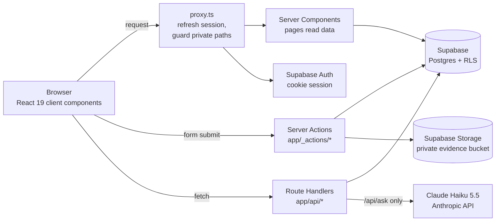
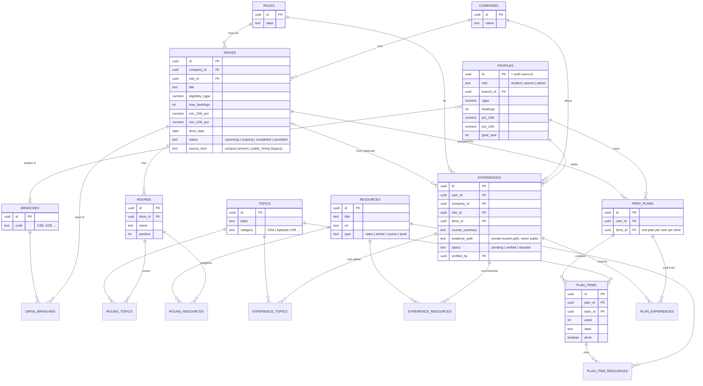
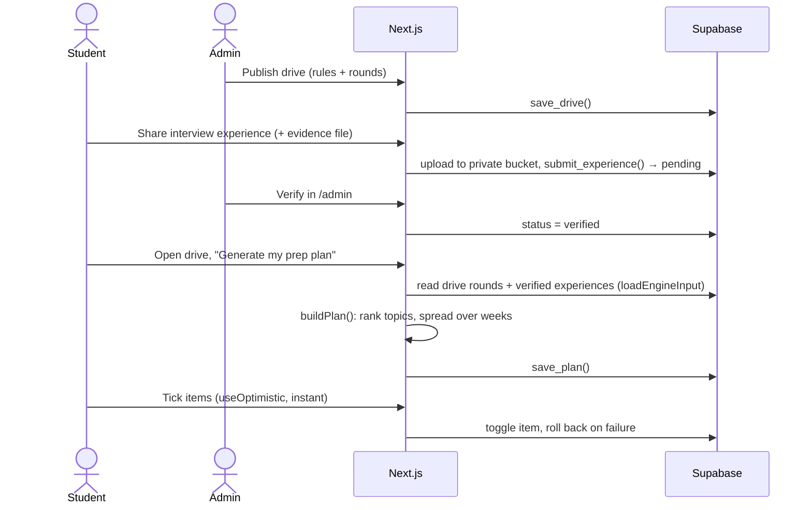

# Architecture

How Beyond the Rumour Mill is built: the system, the database, and the UI. The diagrams are [Mermaid](https://mermaid.js.org/), which GitHub renders on this page.

- [1. System overview](#1-system-overview)
- [2. Database architecture](#2-database-architecture)
- [3. How data moves (the P08 integration)](#3-how-data-moves-the-p08-integration)
- [4. UI architecture](#4-ui-architecture)
- [5. What we used, and why](#5-what-we-used-and-why)

---

## 1. System overview

| Layer | Where | Job |
|---|---|---|
| Proxy | `proxy.ts`, `lib/db/proxy.ts` | Runs before every request. Refreshes the Supabase auth cookie and sends signed-out visitors away from `/dashboard`, `/admin`, `/onboarding`, `/experiences/new`, `/ask`, `/api/plans`. |
| Pages (reads) | `app/**/page.tsx` | Server Components. They query Supabase on the server and send finished HTML; slow parts stream in behind `<Suspense>`. |
| Writes | `app/_actions/*.ts` | Server Actions. Every write validates with Zod (`lib/validation.ts`), checks the user, then calls the database. |
| APIs | `app/api/plans/[id]/export` (GET), `app/api/ask` (POST), `app/auth/confirm` (GET) | Route Handlers for a Markdown export, the AI project guide and email-link sign-in. |
| Database | `supabase/migrations/*.sql` | Postgres with row-level security on every table. The browser never gets more than the policies allow. |

Hosting: the same app runs on a VPS behind nginx (https://clg.143.lat) and on Vercel. Both use one Supabase project.

---

## 2. Database architecture

18 tables, 4 public views, 3 write functions (RPCs), 1 private storage bucket. All in `supabase/migrations/`.

### Entity–relationship diagram

### Tables by module

| P08 module | Tables | Notes |
|---|---|---|
| Shared reference data | `companies`, `roles`, `topics`, `branches`, `resources` | Seeded by migration (`20261028000600_base_taxonomy.sql`). Read-only for everyone except through migrations. |
| Accounts | `profiles` | One row per Supabase Auth user, created by the `handle_new_user` trigger. Holds the eligibility inputs (branch, CGPA, backlogs, 10th/12th %, grad year) and the role. |
| 1. Placement information | `drives`, `drive_branches`, `rounds`, `round_topics`, `round_resources` | A drive's eligibility rules and ordered rounds. No `drive_branches` rows means every branch is eligible. Written only through `save_drive()`. |
| 2. Experience repository | `experiences`, `experience_topics`, `experience_resources` | Student submissions. Start as `pending`; an admin marks them `verified` or `rejected` (with a reason). |
| 3. Student preparation | `prep_plans`, `plan_items`, `plan_item_resources`, `plan_experiences` | A generated week-by-week checklist. `plan_experiences` records which verified experiences a plan was built from (provenance). |

### Security: four layers

| Layer | What it does | Where |
|---|---|---|
| **Row-level security** | Enabled on all 18 tables. Reference data and drives are readable by anyone. Profiles, plans and plan items: only their owner. Experiences: owner or admin; only admins can verify. | `20261027000400_rls_and_grants.sql` |
| **Public views** | The only way anonymous visitors see experiences. `public_experiences` = verified only, safe columns only (no `user_id`, no `evidence_path`). `community_tips` = pending tips with no author info at all. | `20261027000300_public_views.sql` |
| **Write functions (RPCs)** | Multi-table writes run as one transaction inside Postgres: `submit_experience()` (experience + topics + resources), `save_drive()` (drive + branches + rounds + round topics), `save_plan()` (plan + items + resources + provenance). Each re-checks the caller. | `20261027000600_rpcs.sql`, `20261028000200_save_drive.sql`, `20261028000300_…` |
| **Private storage** | Bucket `evidence`: not public, 4 MB limit, image/PDF allowlist. Students can upload; only admins can read, through short-lived signed URLs. | `20261027000500_storage_evidence.sql`, `20261028000400_evidence_4mb.sql` |

Helpers: `is_admin()` (used inside policies), `set_updated_at()` trigger, and indexes on the common lookups (`experiences(company_id, status)`, `drives(status, drive_date)`, `plan_items(plan_id)` …).

The app also checks permissions in code (`requireUser()` / `requireAdmin()` in `lib/auth.ts`), but the database rules are the real wall: even a buggy page cannot read another student's plan.

---

## 3. How data moves (the P08 integration)

**Company requirement → relevant experiences → student preparation plan**

- **Eligibility** (`lib/placement/eligibility.ts`): compares the profile with the drive's rules and says exactly which rule fails.
- **Topic frequency** (`lib/experiences/topic-frequency.ts`): counts how many verified experiences mention each topic.
- **Rumour check** (`lib/experiences/rumour.ts`): "Company X heavily asks topic Y" is Supported at ≥ 50 % of verified experiences, Not supported at ≤ 15 %, Mixed in between, Low sample under 3.
- **Plan engine** (`lib/preparation/plan-engine.ts`): turns the drive's rounds and the most-asked topics into a dated checklist with resources.

All four are pure functions with unit tests in `tests/unit/`.

---

## 4. UI architecture

### Pages

| Route | Who | What it shows | How it renders |
|---|---|---|---|
| `/` | Everyone | Hero, the rumour strip, the rumour register (live verdicts), the rule demo, the 3-module path | Server Component; register streams in via `<Suspense>` |
| `/drives` | Everyone | Campus drives, search + company + "eligible only" filters (query params) | Server Component |
| `/drives/[id]` | Everyone (eligibility when signed in) | Rules, rounds, matched experiences, "Generate my prep plan" | Dynamic route + `generateMetadata` |
| `/companies`, `/companies/[slug]` | Everyone | 12 researched company guides with sources | **SSG** with `generateStaticParams` |
| `/experiences` | Everyone | Verified experiences, topic frequency bars, unverified tips kept separate | Server Component, cached 30 s |
| `/experiences/new` | Signed in | 3-step submit wizard with file upload | Client form → Server Action |
| `/rumour-check` | Everyone | Claim form + verdict with cited experiences | Server Action, `useActionState` |
| `/login`, `/forgot-password`, `/reset-password` | Everyone | Email + password auth | Client forms, Zod on both sides |
| `/onboarding` | Signed in | Profile (branch, CGPA, backlogs …) used for eligibility | Controlled form |
| `/dashboard`, `/dashboard/plans/[id]` | Signed in | Saved plans, weekly checklist, progress, Markdown export | `useOptimistic` checklist + Context |
| `/ask` | Signed in | Ask Claude about this project's code | Client `fetch` reading a streamed answer |
| `/admin`, `/admin/drives` | Admins | Verification queue, counts, drive editor | Layout calls `requireAdmin()` |

Every route group (`(public)`, `(student)`, `(admin)`) has its own `layout.tsx`, `loading.tsx`, `error.tsx` and `not-found.tsx`.

### Components (`components/`, grouped by feature)

| Folder | Main pieces |
|---|---|
| `ui/` | `surface.tsx` (card, PageHeader, EmptyState), `pill.tsx` (buttons, links), `status.tsx` (StatusPill, verdict colours), `field.tsx` (inputs) |
| `nav/`, `footer/` | `SiteNav` (scroll + Escape effects with cleanup), `ThemeToggle`, `AreaNav`, `BrandMark` (`next/image`), `SiteFooter` |
| `drives/` | `DriveCard`, `DriveFilters`, `DriveForm` (admin), `DriveRequirements`, `EligibilityBadge`, `RoundList`, `Countdown` |
| `experiences/` | `SubmitWizard`, `TopicPicker` (+ `hooks/useTopicSearch`), `TopicFrequencyBars`, `ExperienceCard`, `CommunityTipsLane` |
| `rumour/` | `ClaimForm`, `VerdictCard`, `RumourRegister`, `RumourTicker`, `RuleLab` |
| `plans/` | `Checklist` (`useOptimistic`, `useCallback`, `useMemo`), `ChecklistContext` + `useChecklist()`, `ChecklistItem` (`React.memo`), `WeeklyBuckets`, `ProgressBar`, `GeneratePlanButton` |
| `ask/` | `AskBox` (streams the answer, loading / error states) |
| `admin/`, `profile/`, `research/` | Review forms, `ProfileForm`, `CompanyCards` |

### Design system

| Part | Choice |
|---|---|
| Colour | Tokens in `app/globals.css` (`ground`, `panel`, `ink`, `line`, `amber` …). Components never use raw hex. Status colours (green verified, yellow mixed, red rumour) always come with a text label. |
| Themes | Dark and light. `[data-theme="light"]` swaps the token values; `ThemeToggle` flips it and saves the choice; a tiny script in `app/layout.tsx` applies it before first paint (no flash). Default = the device setting. |
| Type | Zodiak (serif headings, italic for quoted rumours) + Switzer (body), both from Fontshare, self-hosted with `next/font/local`. Geist Mono for numbers. |
| Motion | CSS only: the scrolling rumour strip (`animate-marquee`) and the stamp that lands on each rumour card (`stamp-in`). Both are off under "reduce motion". |
| Layout | Tailwind v4 utilities, mobile-first, tested at 390 px and 1440 px. |

Design notes: [`docs/design/design-system.md`](design/design-system.md) and the reference teardown in [`docs/design/bar.md`](design/bar.md).

---

## 5. What we used, and why

| Tool | Used for | Why this and not something else |
|---|---|---|
| **Next.js 16 (App Router)** | Routing, Server Components, Server Actions, Route Handlers, caching, SSG, metadata, proxy | One framework covers the whole INT257 syllabus; no separate backend needed. |
| **React 19** | UI, hooks (`useState`, `useEffect`, `useContext`, `useOptimistic`, `useActionState`, `useCallback`, `useMemo`, `memo`) | INT252. Server data comes from Server Components, so no React Query or Axios. |
| **TypeScript** | Every file | Types from the database (`lib/db/database.types.ts`) catch mistakes before runtime. |
| **Tailwind CSS v4** | All styling, themes, animations | Utility-first styling from INT252 Unit II; tokens make the light theme a single block. |
| **Zod 4** | Validating every form and API body, on client and server | INT252 Unit IV; one schema file (`lib/validation.ts`) shared by both sides. |
| **Supabase** | Postgres, Auth (email + password, cookie session), Storage | Real database with row-level security; replaces an ORM + auth server. |
| **Anthropic SDK (Claude Haiku 5.5)** | `/ask` project guide only | Fast, cheap model; the project source is prompt-cached so answers start in ~2–3 s. Rate-limited per user and per site. |
| **Vitest** | 119 unit tests + RLS tests against a local database | Fast, works with TypeScript out of the box. |
| **Playwright** | End-to-end browser tests (sign in, submit, verify, plan, admin) | Tests the production build like a real user. |
| **GitHub Actions** | CI on every push: lint, typecheck, unit tests, build, migrations, RLS, E2E | Nothing reaches `main` broken. |

Deliberately **not** used (and why) is listed at the end of [`SYLLABUS.md`](../SYLLABUS.md).
